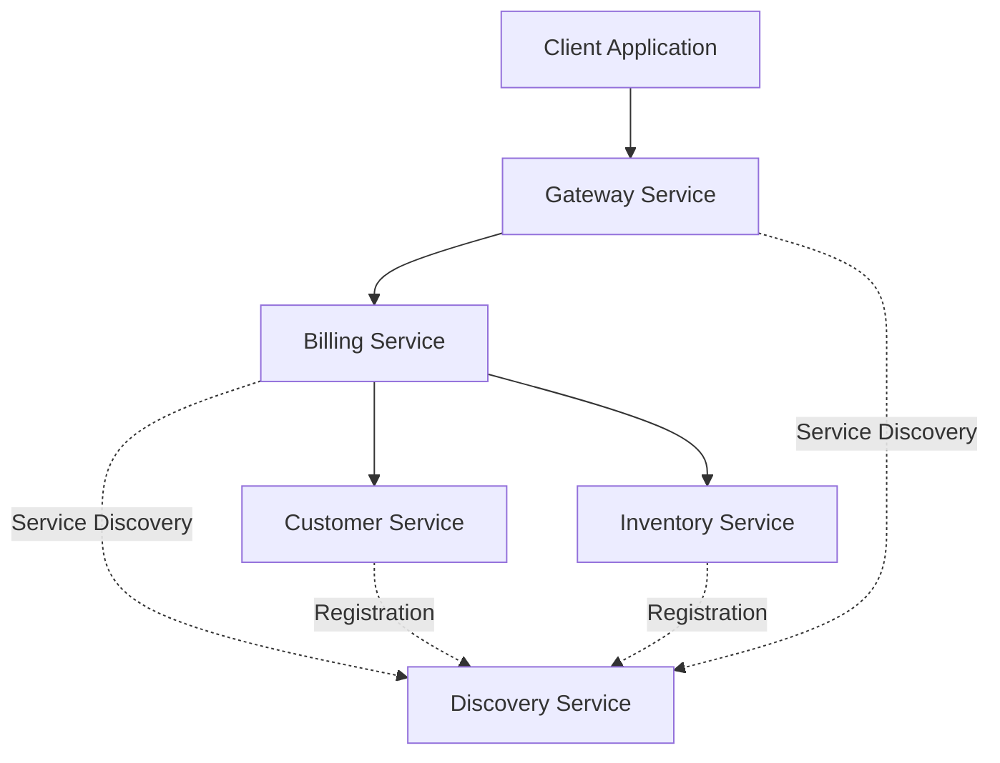

# E-Commerce Microservices Application

A backend e-commerce application developed with **Java, Spring Boot, and Spring Cloud**, following a microservices architecture. The project separates customer management, product inventory, and billing into independent services that communicate through REST APIs.

## Overview

The goal of this project is to explore microservices architecture, service-to-service communication, service discovery, API routing, and fault tolerance in a distributed application.

## Architecture

The application is organized into the following services:

| Service | Responsibility |
|---|---|
| **Customer Service** | Manages customer information and provides customer data through REST endpoints. |
| **Inventory Service** | Manages product information and provides product details. |
| **Billing Service** | Retrieves bills and enriches them with customer and product information. |
| **Discovery Service** | Provides service discovery for registered microservices. |
| **Gateway Service** | Provides an entry point for routing requests to backend services. |

### Architecture Diagram



## Key Features

- **Microservices architecture:** Separates business responsibilities into independent services.
- **Customer management:** Retrieves customer information through REST endpoints.
- **Product management:** Retrieves product information from the inventory service.
- **Billing management:** Retrieves bills and associates them with customer and product details.
- **Inter-service communication:** Uses Spring Cloud OpenFeign for declarative REST clients.
- **Service discovery:** Includes a dedicated discovery service.
- **API gateway:** Includes a gateway service for centralized request routing.
- **Fault tolerance:** Uses Resilience4j Circuit Breaker annotations to support fallback behavior when a remote service is unavailable.

## Technologies Used

- **Language:** Java
- **Framework:** Spring Boot
- **Microservices:** Spring Cloud
- **Service communication:** Spring Cloud OpenFeign
- **Fault tolerance:** Resilience4j
- **Persistence:** Spring Data JPA / Hibernate
- **Database mapping:** Jakarta Persistence (JPA)
- **Boilerplate reduction:** Project Lombok
- **Build tool:** Maven
- **Version control:** Git and GitHub

## Project Structure

```text
ecom-ms-app/
├── billing-service/
│   └── src/
├── customer-service/
│   └── src/
├── discovery-service/
│   └── src/
├── gateway-service/
│   └── src/
├── inventory-service/
│   └── src/
├── pom.xml
└── README.md
```

Each service contains its own application code and configuration.

## Getting Started

### Prerequisites

Install the following tools:

- Java Development Kit (JDK) compatible with the project
- Maven
- An IDE such as IntelliJ IDEA
- A database compatible with the configuration of each service, if required

### 1. Clone the Repository

```bash
git clone https://github.com/lahlou4chaimaa/ecom-ms-app.git
cd ecom-ms-app
```

### 2. Configure the Services

Before starting the application:

1. Review the configuration files of each microservice.
2. Configure database connection details where necessary.
3. Verify the service names and ports.
4. Check the discovery server and gateway configuration.
5. Ensure that the required dependencies are available.

### 3. Build the Project

From the root directory, run:

```bash
mvn clean install
```

If the services are configured as independent Maven projects, build each service from its own directory using the appropriate Maven command.

### 4. Run the Services

Start the services according to their configuration and dependencies:

1. Discovery Service
2. Customer Service
3. Inventory Service
4. Billing Service
5. Gateway Service

The exact startup order and ports depend on the individual service configurations.

## Example API Endpoint

The billing service exposes an endpoint for retrieving a bill by its ID:

```http
GET /api/bills/{id}
```

The endpoint retrieves the bill and enriches the response with customer information and product details obtained through the corresponding Feign clients.

The complete URL depends on the port and routing configuration of the billing service or gateway.

## Learning Objectives

This project provides practical experience with:

- Designing a distributed application using microservices.
- Separating business logic into independent services.
- Implementing REST-based communication between services.
- Integrating Spring Cloud OpenFeign.
- Exploring service discovery and API gateway patterns.
- Applying fault-tolerance mechanisms with Resilience4j.
- Mapping entities and relationships using JPA and Hibernate.
- Managing a Java project with Maven and Git.

## Future Improvements

Potential improvements include:

- Adding centralized configuration management.
- Implementing authentication and authorization.
- Improving validation and exception handling.
- Adding automated unit and integration tests.
- Containerizing services with Docker.
- Adding API documentation with OpenAPI/Swagger.
- Implementing centralized logging and monitoring.

## Author

**Chaimaa Lahlou**

Computer Science and Network Engineering Student

GitHub: [@lahlou4chaimaa](https://github.com/lahlou4chaimaa)

---

*This project is developed for educational purposes to practice backend development and microservices architecture.*
